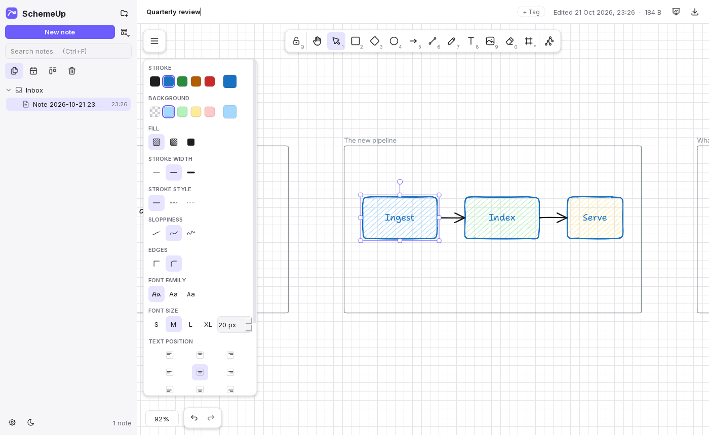
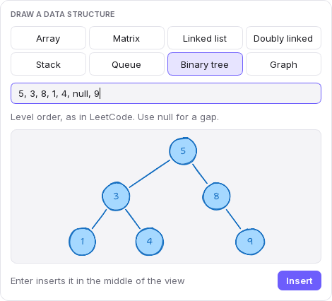
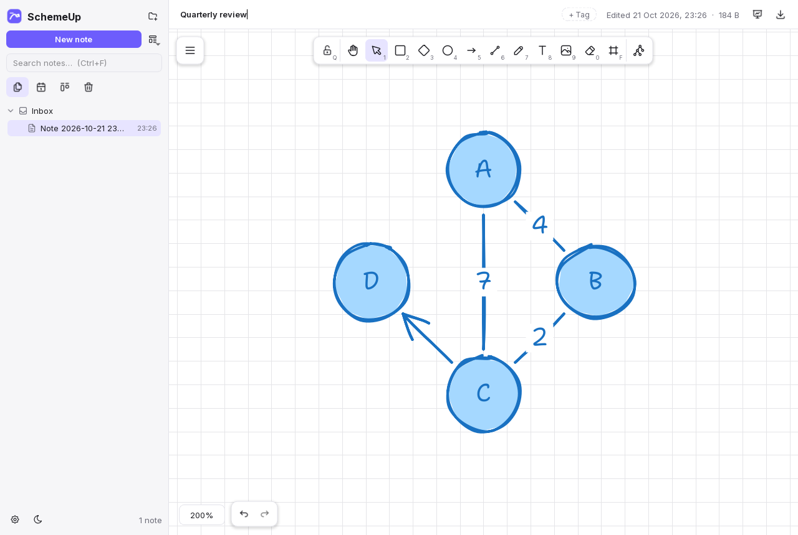
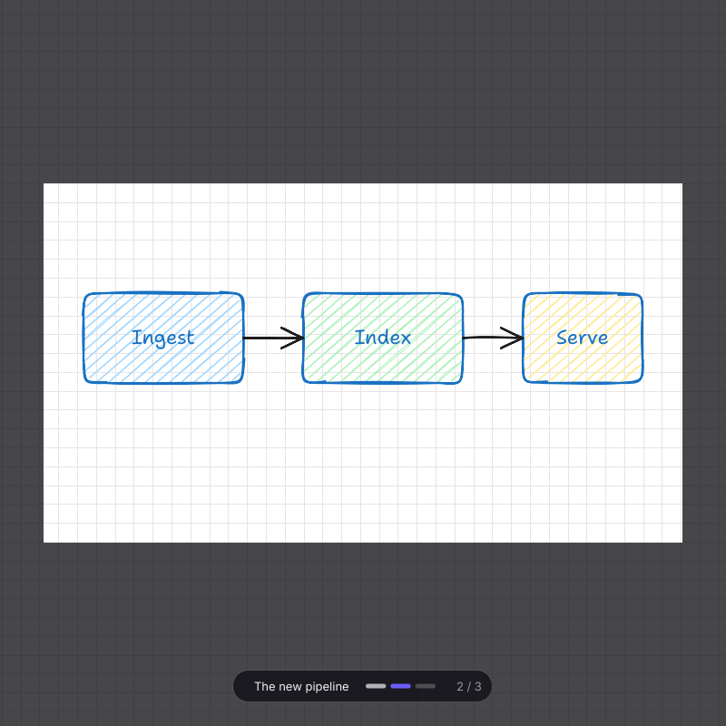

# SchemeUp

SchemeUp is a desktop whiteboard for my own notes. I use Excalidraw a lot for software design sketches and for working through LeetCode problems, but I wanted it offline, with real paper backgrounds and proper snapping. I also wanted all the small meeting notes I write to live in one place instead of in hundreds of text files spread around my disk. So every note here is an infinite canvas, and the app keeps them in its own library with folders, tags, a Kanban board and a calendar.

It's written in Python with PySide6 (Qt) and runs completely offline. There are no accounts and nothing goes to the cloud.



## Status

The app is complete enough to use every day: the canvas, the library, boards, the calendar, export and import all work, and the test suite covers them. Two things are still missing. There is no installer yet, so for now it runs from source, and the interface is English only. The Spanish translation and a Windows installer are next. [docs/architecture.md](docs/architecture.md) has the plan and the reasons behind the main decisions.

## What it does

The canvas draws shapes, arrows, text and freehand strokes with a hand-drawn look, and every note can sit on a different kind of paper: plain, squared in several sizes, lined, Seyès, millimetre, Montessori or double line. Arrows bind to the shapes they connect and follow them when they move. Double-click a shape or an arrow to type inside it. Snapping to shapes and to the sheet is off until I switch it on with Alt+S or Ctrl+', and when it is on it acts like a weak magnet: it catches near a line, holds a little past it, and waits while I am still moving fast.

Notes live in a library with folders, tags, a trash, full-text search that also reads the text inside drawings, and a command palette on Ctrl+K. A global hotkey (Ctrl+Alt+N by default, on Windows) opens a small window to write a quick note from anywhere. Boards arrange notes in columns, and the calendar shows what I created or edited each day. The welcome page adds a year of activity as a grid of squares, with the current and longest streak.

When a note is set to A4, A5 or Letter it becomes a document of pages. A new page appears when content passes the bottom of the last one, and Ctrl+Enter adds an empty one. Only the pages count: whatever lies off them is drawn faded, and it is left out of exports and search.



For LeetCode notes the data structure picker (Ctrl+Shift+D, or the last button on the toolbar) draws arrays, matrices, linked lists, stacks, queues, binary trees and graphs from a line of text. A tree takes the same level-order list LeetCode shows, such as `1, 2, 3, null, 4`, and a graph takes edges such as `A-B, B-C:5, C->D`. The picker shows a live preview, Enter drops the result in the middle of the view as one group, and one undo takes it back. Arrows are bound to their nodes, so moving a node keeps the diagram connected.



Frames turn a note into slides. F5 presents them in reading order: the camera flies from one frame to the next, everything outside the current slide is dimmed, and a thin ribbon at the bottom shows where I am. Arrow keys, space, a click or the wheel move through the slides and Escape leaves. F11 is focus mode, which hides the sidebar and the panels and keeps only the tools.



Notes export to PNG, SVG, PDF and Word, and to `.schemeup` files that keep everything. Excalidraw files import. Exporting a note without frames asks how to cut it into pages and warns when the text would get too small.

## Shortcuts

| Keys | Does |
| --- | --- |
| V H R D O A L P T E F | Select, hand, rectangle, diamond, ellipse, arrow, line, draw, text, eraser, frame |
| Ctrl+K | Command palette: every command and every note |
| Ctrl+N, Ctrl+Alt+N | New note, quick note from anywhere |
| Ctrl+Shift+D | Draw a data structure |
| Ctrl+Enter | Add a page to a paged note |
| F5, F11 | Present the frames, focus mode |
| Alt+S, Ctrl+' | Toggle snapping to shapes, to the sheet |
| Shift+1, Shift+2, Ctrl+0 | Zoom to fit, zoom to selection, back to 100% |
| Ctrl+Shift+E | Export |

## Running it

You need [uv](https://docs.astral.sh/uv/). It takes care of the Python version and installs the dependencies into a local virtual environment.

```
uv sync
uv run schemeup
```

Ctrl + wheel (or a touchpad pinch) zooms around the cursor, the wheel pans, and dragging with the middle button or with Space held down pans with inertia. The window shrinks to half a screen, so it fits next to a problem statement or an editor.

The canvas follows the Windows "Animation effects" setting. With it turned off, camera moves are instant and there's no inertia. You can override that with the `SCHEMEUP_MOTION` environment variable, set to `full` or `reduced`.

## Development

```
uv run pytest
uv run ruff check .
uv run ruff format .
uv run mypy
uv run lint-imports
```

`lint-imports` checks the layering rules. The domain and application code can't import Qt, and the UI and infrastructure layers can't import each other. To run the ruff checks on every commit, run `uv run pre-commit install` once.

The code lives in `src/schemeup`:

- `domain` is the pure Python model.
- `application` holds the use cases.
- `rendering` is the QPainter drawing code that the canvas and the exporters share.
- `infrastructure` deals with storage, the OS and export.
- `ui` has the widgets.

Tests mirror that layout under `tests/`. Frame times are measured with `uv run python benchmarks/canvas_bench.py` and `uv run python -m benchmarks.pan_bench`, and [docs/performance.md](docs/performance.md) keeps the numbers.

## License

MIT. Qt and PySide6 are used under the LGPL v3; see [THIRD_PARTY_NOTICES.md](THIRD_PARTY_NOTICES.md).
