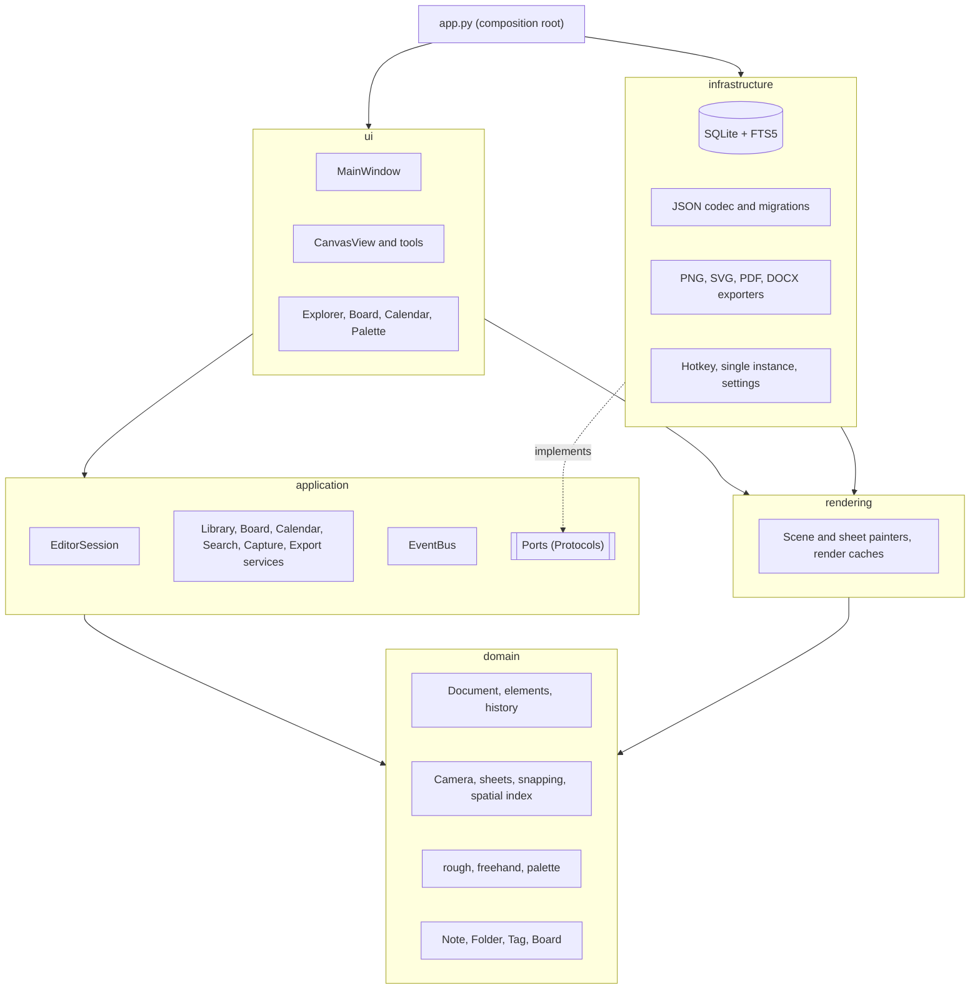

# SchemeUp architecture

This is the design document for SchemeUp. It explains what I'm building, the decisions behind it and the order I plan to build it in. When the code and this document disagree, the code wins and this file needs an update.

## 1. Executive summary

SchemeUp is an offline desktop app for Windows (macOS and Linux when it's cheap to support) where every note is an infinite canvas in the spirit of Excalidraw. The notes live inside the app, in a library with folders, tags, Kanban boards and a calendar. It covers three things I do every week: sketching software designs, reasoning through LeetCode problems, and taking quick meeting notes that today end up as hundreds of forgotten text files.

The main decisions:

| Area | Decision |
|---|---|
| Language and UI | Python 3.12+ with PySide6 (Qt Widgets, LGPL) |
| Canvas | My own QPainter renderer on a plain widget, with layered caching and a spatial index. Not QGraphicsScene. |
| Note model | One note type: a canvas document. Text is just another element. Quick capture opens a canvas with the cursor already inside a text block. |
| Organization | A note lives in exactly one folder. Tags and boards reference notes, never copy them. The calendar is a query. |
| Storage | One SQLite file holds metadata, full-text search (FTS5) and the canvas documents, which are stored as versioned JSON. |
| Export | Frames are the unit of export. PDF and SVG are vector, PNG is raster. DOCX gives editable text plus images of the drawings. |
| Packaging | PyInstaller in folder mode plus an Inno Setup installer, built by GitHub Actions. |
| Budget | Zero. Everything is free and open source, and I checked every license (section 3.7). |

The biggest risk is the feel of the canvas. Python runs the input and paint loop, and I want 60 fps with thousands of elements. My answer is to keep per-frame Python work proportional to what's on screen, push all rasterization into Qt's C++ code and cache aggressively. I'll validate that with a benchmark spike before building real tools on top (section 11). The other risks are scope (Excalidraw is huge, so the MVP is strict), text editing inside the canvas, and the unsigned executable on Windows.

## 2. Resolving the contradictions

### 2.1 Infinite canvas vs PDF and Word

An infinite canvas has no pages, and PDF and Word only have pages. I resolve it with frames. A frame is a named rectangle on the canvas (Excalidraw has them too), and every frame becomes one page when exporting.

If a note has no frames and I try to export it to PDF or Word, the export dialog warns me first and offers three options, each with a live thumbnail of the result:

**Fit to one page** scales all the content onto a single page. The dialog shows the effective text size, and if it drops below 60% of the original it says so in plain words.

**Selection or frames** exports what I selected, or one page per frame.

**Auto-paginate** tiles the content at 100% scale across as many pages as needed and shows where the cuts fall. It's honest but rarely pretty, because elements can get split in two.

The dialog remembers my last choice per note.

On top of that there is a **paged mode**. A note can be created as A4, A5 or Letter (portrait or landscape). The canvas then shows a column of pages and adds a new page when content goes past the last one. Under the hood a page is just a frame with a fixed size, so the export path is the same one. I think it's worth building because it reuses frames almost completely, and it's exactly what I want for LeetCode notes I might print. The extra cost is a few days for page layout, clipping and auto-append, scheduled after frames exist (phase 4).

### 2.2 One note type or two

I considered two note types, a plain text note for meetings and a canvas note for diagrams, and decided against it. Every note is a canvas document, and text is an element type with two width modes: auto (grows with the text, like a label) and fixed (wraps at a given width, like a paragraph).

Quick capture creates a new canvas note with a fixed-width text element at the origin and the caret already inside it. From my side it behaves like a notepad: I press the hotkey and type. If the meeting turns into a whiteboard session, I draw next to the text in the same note, with no conversion step.

Capture speed was the main argument for two types, but speed doesn't come from the note type. It comes from having the process already running, the capture window already created and the focus going straight into the editor (section 7.6). One type also means one renderer, one search extractor and one export path.

### 2.3 Folders, tags and boards

Each concept answers a different question, and none of them duplicates content.

| Concept | Question it answers | Storage |
|---|---|---|
| Folder | Where does this note live? | `notes.folder_id`, exactly one folder per note |
| Tag | What is it about? | `note_tags`, many-to-many |
| Board | Where is it in this workflow? | `board_cards(board_id, note_id, column_id, position)` |

A board card is a reference to a note, not a copy. The column is board-local state. That way the same note can be "Doing" on my "Graphs" board and "To review" on my "Interview prep" board at the same time. The primary key `(board_id, note_id)` means a note appears at most once per board. I deliberately don't encode columns as tags: that couples two concepts, and moving a card would silently change the note's tags.

### 2.4 How much of Excalidraw, and when

Copying all of Excalidraw is out of scope for the first year. The MVP (phase 1) includes these tools:

- Selection with move, resize and rotate, plus the hand tool.
- Rectangle, diamond, ellipse, line and arrow.
- Freehand, text and the eraser.

It also includes the properties panel:

- Stroke and fill color, fill style (hachure, cross-hatch, solid) and stroke width.
- Stroke style (solid, dashed, dotted), roughness (sloppiness) including the clean mode, and opacity.
- Roundness, layer order, duplicate, lock, and group/ungroup.

Undo and redo, snapping, arrow binding, text inside shapes, sheet types and the background color are part of the MVP too. Images come in phase 2, together with the asset store, and frames in phase 4.

What I'm not replicating early: elbow arrows, shape libraries, web embeds, the laser pointer, Mermaid and text-to-diagram, image cropping, links from elements to URLs, live collaboration, zen and view modes, and more than three font families. Some may come later. Others, like collaboration, conflict with the offline single-user idea and won't come at all.

### 2.5 Grid snapping vs shape snapping

Snapping resolves each axis independently. On each axis I collect candidates from every snap engine within a threshold of 8 screen pixels and pick by priority class first, then by distance:

1. Arrow binding to a shape (only for arrow endpoints).
2. Object snaps: edges, centers and equal spacing with nearby elements.
3. Grid or sheet lines.

The grid comes last for a simple reason. On a grid there's always a line within reach, so if the grid had priority it would hide every alignment with real shapes. The grid only applies on an axis where no object snap was found. So a shape can align its left edge with another shape on X and sit on a grid line on Y.

Object snaps draw temporary guides. Grid snaps don't, because the grid itself is visible. A small hysteresis (the snap only breaks 3 px past the threshold) stops the jitter when the cursor sits on a boundary. Holding Ctrl while dragging bypasses snapping, Alt+S toggles object snapping and Ctrl+' toggles grid snapping, as in Excalidraw.

### 2.6 Pastel colors as strokes

Pastels are lovely as fills and bad as strokes. I measured the WCAG contrast ratios of the pastels I like against a white canvas: they land between 1.2:1 and 1.7:1, while non-text graphics need at least 3:1. A light-blue arrow on white is almost invisible.

So each of the four hues has two tones: a pastel for fills and a deep tone for strokes and text. The fill picker shows the pastels and the stroke picker shows the deep tones. Both pickers keep the same order, so the palette still feels like one family. The numbers are in section 7.3.

Dark mode doesn't need a separate palette. Colors are stored as authored and transformed at render time with the same math as the CSS filter `invert(93%) hue-rotate(180deg)`, which is what Excalidraw does. White becomes #121212, black strokes become light grey, and pastel fills become dark tints of the same hue. Exports use the authored colors unless I pick a dark export.

### 2.7 One source of truth

The SQLite tables are the only truth. The explorer, the boards and the calendar are views computed from them. Nothing is cached in a second place that could drift.

The application layer publishes events (`NoteCreated`, `NoteRenamed`, `NoteMoved`, `NoteTrashed`, `TagsChanged`, `CardMoved`) after each transaction commits. The views subscribe and re-query what they show. Renaming a note in the explorer updates its board card and its calendar entry because all three read the same row.

The calendar shows creation dates from `notes.created_at`. For "edited on this day" there is a small append-only `note_activity` table (note, local date, number of saves), which also feeds the statistics later. It's event data, not a copy of anything.

## 3. Stack

### 3.1 Comparison

| Option | Canvas performance and quality | Text editing, IME | Export | Desktop integration | License | Verdict |
|---|---|---|---|---|---|---|
| **PySide6 + custom QPainter canvas** | C++ raster engine, antialiasing, high-DPI | Real Qt text widgets | QPdfWriter, QSvgGenerator, QImage | Tray, native dialogs, global hotkeys via the Win32 API | LGPL-3.0 | **Chosen** |
| PyQt6 | Same as PySide6 | Same | Same | Same | GPL-3.0 or commercial | Rejected, it would force the app to be GPL |
| PySide6 + QGraphicsScene | Good for static scenes, see 3.2 | Good | Same | Same | LGPL-3.0 | Rejected for the canvas |
| Tkinter / CustomTkinter | The Tk canvas doesn't antialias lines on Windows | Basic | None built in | Weak high-DPI support | PSF / MIT | Rejected |
| Dear PyGui | Fast GPU immediate mode | Weak, limited IME | No printing or PDF | Small ecosystem, non-native look | MIT | Rejected |
| Flet | Python drives a Flutter UI through a message channel, so every canvas update gets serialized | Good | Limited | Heavy runtime | Apache-2.0 | Rejected |
| pywebview + web frontend | Excellent (it could embed Excalidraw itself) | Excellent | Browser APIs | OK | BSD + MIT | Rejected, see below |
| Qt Quick (QML) | GPU scene graph | Good | No shared QPainter path | Good | LGPL-3.0 | Rejected |

The pywebview option deserves an honest note. It's probably the fastest way to reach Excalidraw parity, because Excalidraw is an MIT React component I could embed directly. But then the core of the project, the canvas, would be TypeScript, and Python would be glue around a database. For a project whose point is to be a serious Python application, that defeats the purpose. QML has a similar problem in a milder form. It adds a third language, every element becomes a scene-graph item driven from Python, and export couldn't reuse the same QPainter code as the screen.

### 3.2 Why a custom canvas instead of QGraphicsScene

QGraphicsScene was my first idea, and it has real strengths: a C++ BSP index, built-in hit testing and per-item caching. Three problems pushed me away from it.

The cache modes don't fit an infinite canvas. With `DeviceCoordinateCache`, Qt regenerates an item's cache whenever its transformation changes, and zooming the view counts as a transformation. Every zoom step would repaint every visible item from Python. `ItemCoordinateCache` avoids that but renders at a fixed resolution, so text and lines get blurry when zooming in.

The scene would also be a second copy of the document. Every element would exist once in my domain model and once as a QGraphicsItem, and keeping the two in sync is a classic source of bugs. With a custom renderer the document is the only state, and drawing is a function of the document, the camera and the interaction state.

Finally, I need hit testing and snapping queries in pure Python anyway, so they can be unit-tested without Qt. Once I have my own spatial index, the main thing QGraphicsScene offers is a rendering loop I can't fully control.

The price is that I write selection, hit testing and invalidation myself. That code is also some of the most interesting in the project.

### 3.3 What Python can and can't do here

Python has a global interpreter lock (the GIL), so only one thread runs Python bytecode at a time. The UI thread handles input, updates the model and issues paint calls. If it spends 30 ms in Python, a frame is lost, no matter how many cores the machine has.

The rule that follows: per-frame Python work must be proportional to what's visible, and cheap per element. Rasterizing paths, antialiasing, compositing pixmaps and laying out text all happen inside Qt's C++ code. Python decides *what* to draw, and Qt draws it. Geometry (the wobbly rough.js paths, the freehand outlines) is regenerated only when an element changes, never just because the camera moved.

Work that can wait goes to background threads: autosave, search indexing, backups, thumbnails and export. Threads still help despite the GIL, because `sqlite3` releases the GIL while SQLite works, and a QPainter drawing into a QImage in a worker thread runs C++ code. QPixmap must stay on the GUI thread, so workers render into QImage.

If profiling shows a pure-Python hotspot (likely candidates are the rough generator, the freehand outline and snapping), the escape hatch is mypyc. It compiles fully type-annotated modules into C extensions, and since the domain is strictly typed anyway, it costs almost nothing to try. I'm not counting on free-threaded Python builds.

### 3.4 Persistence

Everything goes into one SQLite database file: metadata, the folder tree, tags, boards, the FTS5 search index, the canvas documents (as versioned JSON text) and images (as blobs keyed by their SHA-256).

The alternative was a folder of JSON files on disk plus a SQLite index, like an Obsidian vault. I rejected it because the problem I'm solving is exactly a mess of scattered files. With a vault, files and index form two sources of truth that can disagree after a crash or an external edit. A single database gives me transactions across metadata and content for free. Moving a note, retagging it and saving its content can't half-happen. Backups are one call to SQLite's online backup API.

The JSON document is still the canonical format of a canvas: it's what's stored in the database, what gets exported as a `.schemeup` file and what migrations operate on. I didn't normalize elements into SQL tables because a canvas is loaded and saved as a unit, and I never need to query individual elements with SQL.

The database runs in WAL mode with `synchronous=NORMAL`. With WAL, a crash of the app can never corrupt the database. A power cut can lose the last transaction or two, but never leaves a broken file.

### 3.5 Tooling

| Tool | Role | Why this one |
|---|---|---|
| uv | Python versions, virtual environments, lockfile | One fast tool, similar to Go modules or Cargo. `uv.lock` pins every transitive dependency. |
| pyproject.toml + hatchling | Project metadata and build | The standard Python project file, roughly what `go.mod` or a CMakeLists is for those ecosystems. |
| ruff | Linter and formatter | Replaces flake8, isort and black with one tool. |
| mypy (strict) | Static type checking | Catches the errors a C++ compiler would. It also enables mypyc later. |
| pytest, pytest-qt, hypothesis | Unit, widget and property-based tests | pytest fixtures work as dependency injection for tests. Hypothesis generates inputs for math-heavy code like the camera and snapping. |
| import-linter | Checks the layer rules in CI | Turns "the domain must not import Qt" into a failing build instead of a convention. |
| pre-commit | Runs ruff before each commit | Optional locally, CI checks the same things anyway. |

For readers coming from C++ or Go like me, a few Python idioms appear everywhere in the code. `typing.Protocol` is structural typing: a class satisfies a protocol if it has the right methods, without inheriting from it, just like Go interfaces. `@dataclass(frozen=True, slots=True)` is a small immutable value type, close to a struct with const members. Pattern matching with `match` over a union of element classes replaces a switch over a tagged union.

### 3.6 Packaging and the unsigned executable

PyInstaller bundles the interpreter, the code and Qt into a folder with an `.exe`, and Inno Setup turns that folder into an installer. Releases also include a portable zip of the same folder.

I compared it with Nuitka. Nuitka compiles Python to C, so the startup is a bit better, but its builds take much longer in CI. More importantly, recent versions are licensed under the AGPL-3.0. I couldn't find primary-source wording for an exception covering compiled programs, and I won't build on a legal question mark. PyInstaller's license (GPL with a bootloader exception) explicitly allows bundling programs under any license.

I avoid PyInstaller's one-file mode. A one-file exe extracts itself to a temporary folder on every launch, which makes startup slow. That self-extracting behavior is also what antivirus heuristics flag most often. The folder mode starts fast and keeps the Qt DLLs as separate files, which matters for the LGPL (section 3.7).

A code-signing certificate costs money, so the executable is unsigned, and Windows SmartScreen will show "Windows protected your PC" on first launch. I handle that at zero cost:

- The README explains the "More info" then "Run anyway" step with a screenshot.
- Each release publishes SHA-256 checksums.
- Each release gets a GitHub build-provenance attestation (free for public repositories), proving the binary was built by the public workflow from a given commit.
- Once there are public releases, I'll apply to the SignPath Foundation, which signs open-source projects for free.
- If Microsoft Defender flags a build, I'll submit it as a false positive through Microsoft's free portal.

### 3.7 Licenses and cost

| Component | License | What it means for me |
|---|---|---|
| Python | PSF | No restrictions. |
| PySide6 / Qt (Essentials only) | LGPL-3.0 | The app can be MIT. Qt must stay dynamically linked and replaceable, I must ship the LGPL text and a notice, and I must point to Qt's source. The folder-mode build satisfies the replaceability requirement. I avoid GPL-only Qt modules such as Qt Charts, Qt Data Visualization and Qt Virtual Keyboard, so statistics charts are drawn by hand with QPainter. |
| SQLite | Public domain | None. |
| python-docx | MIT | Keep the notice. |
| rough.js, perfect-freehand (algorithms ported to Python) | MIT | Keep their copyright notices in `THIRD_PARTY_NOTICES.md`. |
| Open Color (palette values) | MIT | Same. |
| Tabler icons | MIT | Same. |
| Shantell Sans, Inter, JetBrains Mono | SIL OFL-1.1 | Can be bundled. The OFL text ships with them, and the fonts can't be sold on their own. |
| Pygments (later, code blocks) | BSD-2-Clause | Keep the notice. |
| PyInstaller | GPL-2.0+ with bootloader exception | Doesn't affect the app's license. |
| Inno Setup | Inno Setup License (permissive) | Free, commercial use allowed. |
| uv, hatchling, ruff, mypy, pytest, pytest-qt, import-linter, pre-commit | MIT / Apache-2.0 / BSD | Development only, never shipped. |
| hypothesis | MPL-2.0 | Development only, never shipped. |
| GitHub, GitHub Actions | Free for public repositories | CI and releases cost nothing. |

The app itself is MIT. Nothing in the plan needs a paid API, a cloud service, a subscription or a paid asset.

## 4. Architecture

### 4.1 Layers

The code is split into five packages under `src/schemeup`, plus `app.py` as the composition root.

**`domain`** is plain Python: geometry, the camera, inertia, canvas elements, the document, undo history, snapping, sheet types, the rough and freehand generators, the color palette, and the library entities (Note, Folder, Tag, Board, Column, Card). It doesn't import Qt and doesn't do I/O, which is why most of the test suite runs in milliseconds.

**`application`** contains the use cases and the interfaces they need. The use cases are `EditorSession`, `LibraryService`, `SearchService`, `BoardService`, `CalendarService`, `CaptureService` and `ExportService`. The interfaces ("ports") are written as Protocols: repositories, `DocumentStore`, `AssetStore`, `SearchIndex`, `TextMeasurer`, `Clock`, `GlobalHotkey` and `SettingsStore`. This layer also has a small synchronous event bus. It depends only on the domain.

**`rendering`** is the QPainter code that draws a document: sheet, elements and caches. It depends on the domain and on Qt, but has no widgets. Both the canvas widget and the exporters use it, which guarantees that the PNG, SVG and PDF look like the screen.

**`infrastructure`** implements the ports: SQLite repositories and migrations, the JSON codec, a Qt-based text measurer, the exporters, the Windows global hotkey, single-instance handling and settings.

**`ui`** has the widgets: the main window, the canvas widget with its tools, panels, the explorer, the board and calendar views, and the command palette.

`app.py` builds every object and passes dependencies through constructors. There are no singletons or module-level state, apart from the QApplication that Qt itself requires.



### 4.2 Dependency rules

Dependencies point inwards: `domain` ← `application` ← `ui` and `infrastructure`. `rendering` sits next to the domain and may only import the domain and Qt. The UI and infrastructure never import each other. They meet in `app.py`, where infrastructure objects get passed to the UI as implementations of application ports.

These rules are enforced by import-linter contracts in `pyproject.toml`, and CI fails if one breaks. One contract forbids `PySide6` in `domain` and `application`, so those layers can't accidentally depend on Qt.

### 4.3 Patterns

I use a handful of patterns where they solve a concrete problem.

**Command**, for undo and redo. Every edit produces a `Changeset` with the before and after state of the elements it touched (section 6.9).

**Strategy** in four places:
- Sheet types, each describing its own lines and snap lattice.
- Snap engines.
- Canvas tools, one class per tool.
- Exporters, one per format.

**Observer** comes in two flavours: the pure-Python event bus in the application layer, and Qt signals inside the UI.

**Repository and unit of work.** Repositories hide SQL behind domain-shaped methods, and one transaction context groups the changes a use case makes.

**State machines** for the tools. Take the selection tool: idle, dragging, resizing, rotating and rubber-band selection are explicit states, which makes pointer handling much easier to reason about than a pile of flags.

**Dependency injection** through constructors, wired in the composition root.

### 4.4 Threading

The GUI thread owns the widgets, the open document and all domain logic. A single background writer thread owns the SQLite write connection, and autosaves, imports and backups go through it in order. The GUI thread keeps its own read-only connection for quick queries like the explorer tree or search. WAL mode lets readers and the writer work at the same time. Long jobs like export run in a `QThreadPool` worker and report back through Qt signals. Because documents are immutable, handing a snapshot to another thread is safe without locks.

### 4.5 Errors and logging

Errors that the user can act on are exceptions from a small hierarchy rooted at `SchemeUpError`: `NotFoundError`, `ConflictError` (for example a folder name already taken), `StorageError`, `UnsupportedFormatError` (a file from a newer version) and `ExportError`. The UI catches them at its boundaries and shows a short message or a toast. There are no bare `except:` blocks.

Unexpected exceptions go to `sys.excepthook` and `threading.excepthook`. The hook writes the traceback to a rotating log file in the app data folder, flushes the open document if it can, and tells the user something went wrong without killing the app.

## 5. Data model

### 5.1 Entities

A **Note** has a title, a folder, timestamps, tags, and one canvas document. A **Folder** has a name and a parent, and the tree has a single root row. A **Tag** is a name with an optional color. A **Board** has ordered **Columns**, and a **Card** places a note in a column of a board. An **Asset** is an image stored once and referenced from documents by hash.

Inside a document, elements are frozen dataclasses grouped in a union type, and code that handles them pattern-matches over that union:

```python
type Element = Rectangle | Diamond | Ellipse | Line | Arrow | Freedraw | Text | Image | Frame


def label_box(element: Element) -> Rect | None:
    match element:
        case Rectangle() | Diamond() | Ellipse():
            return inner_box(element)
        case Line() | Arrow():
            return midpoint_box(element)
        case _:
            return None
```

### 5.2 SQL schema

This is version 1. The database stores its schema version in `PRAGMA user_version`, and migrations are numbered SQL files applied in order inside one transaction.

```sql
CREATE TABLE folders (
    id          INTEGER PRIMARY KEY,
    uuid        TEXT NOT NULL UNIQUE,
    parent_id   INTEGER REFERENCES folders(id) ON DELETE CASCADE,  -- NULL only for the root
    name        TEXT NOT NULL,
    position    INTEGER NOT NULL DEFAULT 0,
    created_at  INTEGER NOT NULL,                                  -- unix ms, UTC
    trashed_at  INTEGER
);
CREATE UNIQUE INDEX folders_sibling_name
    ON folders(parent_id, name COLLATE NOCASE) WHERE trashed_at IS NULL;

CREATE TABLE notes (
    id          INTEGER PRIMARY KEY,        -- also the FTS rowid, stable across VACUUM
    uuid        TEXT NOT NULL UNIQUE,       -- identity in exported files and note links
    folder_id   INTEGER NOT NULL REFERENCES folders(id),
    title       TEXT NOT NULL,
    created_at  INTEGER NOT NULL,
    updated_at  INTEGER NOT NULL,
    trashed_at  INTEGER,
    size_bytes  INTEGER NOT NULL DEFAULT 0
);
CREATE INDEX notes_folder ON notes(folder_id) WHERE trashed_at IS NULL;
CREATE INDEX notes_created ON notes(created_at);
CREATE INDEX notes_updated ON notes(updated_at);

CREATE TABLE note_documents (
    note_id         INTEGER PRIMARY KEY REFERENCES notes(id) ON DELETE CASCADE,
    schema_version  INTEGER NOT NULL,
    body            TEXT NOT NULL,          -- canvas JSON
    plain_text      TEXT NOT NULL           -- all text and labels in reading order, for search
);

CREATE TABLE tags (
    id     INTEGER PRIMARY KEY,
    name   TEXT NOT NULL UNIQUE COLLATE NOCASE,
    color  TEXT
);

CREATE TABLE note_tags (
    note_id  INTEGER NOT NULL REFERENCES notes(id) ON DELETE CASCADE,
    tag_id   INTEGER NOT NULL REFERENCES tags(id) ON DELETE CASCADE,
    PRIMARY KEY (note_id, tag_id)
) WITHOUT ROWID;

CREATE TABLE boards (
    id          INTEGER PRIMARY KEY,
    name        TEXT NOT NULL,
    position    INTEGER NOT NULL DEFAULT 0,
    created_at  INTEGER NOT NULL
);

CREATE TABLE board_columns (
    id        INTEGER PRIMARY KEY,
    board_id  INTEGER NOT NULL REFERENCES boards(id) ON DELETE CASCADE,
    name      TEXT NOT NULL,
    position  INTEGER NOT NULL,
    UNIQUE (id, board_id)                   -- target of the composite key in board_cards
);

CREATE TABLE board_cards (
    board_id   INTEGER NOT NULL,
    note_id    INTEGER NOT NULL REFERENCES notes(id) ON DELETE CASCADE,
    column_id  INTEGER NOT NULL,
    position   INTEGER NOT NULL,
    PRIMARY KEY (board_id, note_id),        -- a note appears at most once per board
    FOREIGN KEY (column_id, board_id)
        REFERENCES board_columns(id, board_id) ON DELETE CASCADE
) WITHOUT ROWID;

CREATE TABLE assets (
    sha256      TEXT PRIMARY KEY,
    mime        TEXT NOT NULL,
    data        BLOB NOT NULL,
    width       INTEGER,
    height      INTEGER,
    created_at  INTEGER NOT NULL
);

CREATE TABLE note_activity (
    note_id  INTEGER NOT NULL REFERENCES notes(id) ON DELETE CASCADE,
    day      TEXT NOT NULL,                 -- local date, YYYY-MM-DD
    edits    INTEGER NOT NULL DEFAULT 0,
    PRIMARY KEY (note_id, day)
) WITHOUT ROWID;
CREATE INDEX note_activity_day ON note_activity(day);

CREATE VIRTUAL TABLE notes_fts USING fts5(
    title, body, tags,
    tokenize = 'unicode61 remove_diacritics 2',
    prefix = '2 3'
);
```

A few details are worth explaining.

**Integer keys.** Notes have an integer primary key because FTS5 rows are addressed by integer rowid. SQLite may renumber implicit rowids during VACUUM unless the table declares an `INTEGER PRIMARY KEY`. The `uuid` column is the stable identity outside the database, in exported files and in links between notes.

**Content in its own table.** The canvas JSON lives in `note_documents`, so listing a folder never reads large rows.

**Card integrity.** The composite foreign key on `board_cards` guarantees that a card's column belongs to the card's board, without application code having to check.

**Search.** The tokenizer strips accents, so searching "dinamica" finds "dinámica". The prefix indexes make search-as-you-type fast on the last partial word. The repository updates `notes_fts` in the same transaction that saves the document, so the index can't drift from the content.

**Trash.** Trashing sets `trashed_at` on a folder, its whole subtree and the notes inside it, all with the same timestamp. Restoring clears every row with that timestamp in one update. Rows in the trash are purged after 30 days, which is configurable.

**Ordering.** Positions are dense integers. Moving a card rewrites the positions of the cards in the affected column within one transaction. Columns hold tens of cards, not millions, so the simple approach wins.

Version history arrives later as a `note_revisions` table (note, timestamp, schema version, body) in migration 2.

### 5.3 Canvas document format

```json
{
  "format": "schemeup.canvas",
  "version": 1,
  "settings": {
    "background": "#ffffff",
    "sheet": { "type": "grid", "params": { "cell_mm": 5 } },
    "page": null
  },
  "elements": [
    {
      "id": "k3f9a1",
      "type": "rectangle",
      "x": 120.0, "y": 80.0, "width": 220.0, "height": 96.0, "angle": 0.0,
      "seed": 1830327412,
      "version": 4,
      "locked": false,
      "group_ids": [],
      "frame_id": null,
      "style": {
        "stroke_color": "#1971c2", "fill_color": "#a5d8ff", "fill_style": "hachure",
        "stroke_width": 2, "stroke_style": "solid", "roughness": 1,
        "opacity": 100, "roundness": "round"
      },
      "label": {
        "text": "API gateway", "font": "hand", "font_size": 20,
        "color": "#1e1e1e", "position": "center"
      }
    },
    {
      "id": "p02c7e",
      "type": "arrow",
      "x": 344.0, "y": 128.0, "width": 180.0, "height": 0.0, "angle": 0.0,
      "seed": 99120345,
      "version": 2,
      "locked": false,
      "group_ids": [],
      "frame_id": null,
      "style": {
        "stroke_color": "#1e1e1e", "fill_color": "transparent", "fill_style": "solid",
        "stroke_width": 2, "stroke_style": "solid", "roughness": 1,
        "opacity": 100, "roundness": "round"
      },
      "points": [[0, 0], [180, 0]],
      "start_binding": { "element_id": "k3f9a1", "anchor": [1.0, 0.5], "gap": 4 },
      "end_binding": null,
      "start_head": null,
      "end_head": "arrow",
      "label": {
        "text": "API", "font": "hand", "font_size": 16,
        "color": "#1e1e1e", "position": "center"
      }
    }
  ]
}
```

The array order is the z-order. Keys are snake_case to match the Python code. Coordinates are canvas units, and 1 mm equals 96/25.4 units (a CSS reference pixel), so an A4 page is 793.7 by 1122.5 units and prints at true size. The `seed` keeps the hand-drawn wobble identical every time the element is drawn. The `version` increments on every change and is what render caches key on.

Inside the database, images reference the `assets` table by hash. An exported `.schemeup` file is the same JSON plus a `note` block (title, tags, dates) and a `files` map with the images base64-encoded, so a single file carries everything.

### 5.4 Versioning and migrations

Each document carries its format version. On load, the codec applies a chain of migration functions, each a plain `dict -> dict` function from version N to N+1, until it reaches the current version. Then it builds the typed objects. Every past version gets a fixture file in `tests/fixtures/documents/`, and a test loads each one through the full chain.

A document from a newer version than the app understands raises `UnsupportedFormatError`, and the note opens read-only with a message. The app never half-loads it, and never saves it back with fields missing.

The database schema works the same way with numbered SQL migrations and `PRAGMA user_version`. Before applying migrations, the app makes a backup copy of the database file.

## 6. Canvas engine

### 6.1 Coordinates and camera

World coordinates are canvas units with Y pointing down. The camera stores the world point at the top-left corner of the viewport plus a zoom factor between 0.1 and 30, so `screen = (world - origin) * zoom`. Screen coordinates are Qt logical pixels, and Qt handles the device pixel ratio on high-DPI displays.

The camera is an immutable value with pure methods:
- `to_screen` and `to_world`.
- `visible_rect`.
- `panned_by`, for a delta in screen pixels.
- `zoomed_at` and `with_zoom_at`, which keep the world point under the cursor fixed while the zoom changes.
- `centered_on` and `fitted_to`.

Being pure, it's covered by property-based tests. One of them checks that the point under the cursor stays put for any camera, cursor and zoom factor.

Input follows Excalidraw by default: the wheel pans, Shift+wheel pans sideways, and Ctrl+wheel zooms. A touchpad pinch zooms too; Windows sends it as Ctrl+wheel, and macOS as a native gesture. A setting will let mouse users make the plain wheel zoom.

Camera motion follows the rules Apple describes in *Designing Fluid Interfaces*. Every animation starts from what's on screen right now, keeps the speed it already has, and can be grabbed or redirected at any moment. The tool for that is the spring, so the domain has a small `Spring` type described with Apple's two parameters. The damping ratio sets the bounce (1.0 means none) and the response sets how quickly it gets there. It steps with the closed-form solution of the damped oscillator, so it moves the same at 60 Hz and at 144 Hz. Changing its target keeps its position and velocity, which is what makes a redirect smooth instead of a "brick wall".

A notched mouse wheel jumps 120 units per click, which feels jerky. Each click only moves the target of a stiff, critically damped spring (response 0.15 s), one for zoom in log space and one per pan axis. Fast clicks blend into a single smooth motion instead of a pulse per click. Touchpad input is already smooth and is applied directly.

Panning by dragging (middle button, or Space plus left button) records the pointer positions from the last 80 ms. On release, the view keeps gliding with that velocity and decays exponentially, using UIScrollView's normal deceleration rate (0.998 per millisecond, a time constant of about half a second). The decay uses the exact integral of the motion, so the glide distance doesn't depend on the frame rate. Grabbing the canvas again catches it where it is.

The different motions are independent channels that add up in one frame loop: the wheel zoom spring, the wheel pan springs, the glide and the recenter spring. Zooming doesn't stop a glide that's still running. When new input interrupts a recenter, the recenter's current speed becomes a glide, so the old motion blends into the new one. The frame timer ticks once per display refresh, so 120 and 144 Hz screens get every frame.

The zoom limits are soft. Zooming past 3000% or below 10% stretches a little with iOS's rubber-band formula and never goes more than 2x past the limit. 150 ms after the input stops, it springs back. A hard stop would feel frozen; the stretch says "there's nothing more here" while still responding.

When the system asks for reduced motion (on Windows, "Animation effects" turned off), the camera jumps straight to its destination: no springs, no glide, no rubber band. Until there's a settings screen, the `SCHEMEUP_MOTION` environment variable (`full` or `reduced`) overrides the system.

### 6.2 Rendering pipeline

At 60 Hz a frame has 16.7 ms. The renderer draws five layers, from bottom to top.

1. **Background.** One `fillRect` with the canvas color.
2. **Sheet.** The lines of the sheet type for the visible area only, drawn in screen space with a 1 px cosmetic pen and antialiasing off, batched into one `drawLines` call per line family. It's cheap enough to draw every frame (section 6.4).
3. **Static elements.** Every element that isn't being edited is rendered into an offscreen pixmap that covers the viewport plus a margin, at the current zoom and device pixel ratio.
   - Panning just blits that pixmap at an offset, and the pixmap is re-rendered only when the view leaves the margin.
   - During a zoom gesture, the pixmap is drawn scaled. It's slightly blurry for a moment, but instant. About 120 ms after the last zoom event it's re-rendered crisp.
   - When the document changes, only the dirty rectangle (old bounds plus new bounds) is re-rendered.
4. **Active elements.** Elements being drawn, dragged or resized are excluded from the static pixmap and drawn directly every frame. That's usually a handful, so it's cheap. A drag re-renders the static layer once at the start and once at the end, not on every mouse move.
5. **Overlays.** Selection boxes, handles, binding highlights, snap guides and the rubber band, drawn in screen space so they stay crisp at any zoom.

Under the static layer there are two caches. Each element caches its `QPainterPath` objects keyed by `(id, version)`. Since those paths are in world units, re-rendering at a new zoom only rasterizes them again and never regenerates geometry in Python. For elements that are expensive to rasterize (long freehand strokes, big text blocks), a second cache keeps a pixmap per zoom bucket (powers of √2), the same idea Excalidraw uses. I'll only add that second cache if the spike shows it's needed.

Culling uses the spatial index, so the static layer only touches elements whose bounds intersect the visible area. There is also a level-of-detail rule: an element smaller than a few pixels on screen is drawn with its clean geometry, because rough strokes are invisible at that size anyway.

### 6.3 Spatial index and hit testing

The spatial index is a uniform grid hash in pure Python. The world is divided into 512-unit cells, and each element is registered in every cell its bounding box touches. Elements spanning more than 64 cells go into a separate oversized list that every query checks. Insert, update and remove are O(1) per touched cell. A query unions the cells that overlap a rectangle.

I chose this over an R-tree because it's about a hundred lines, it's easy to test, its updates are cheap (elements move constantly), and canvas elements have similar sizes, which is the case where grids shine.

Hit testing uses the ideal geometry, not the wobbly rough paths, and works in the element's local coordinates so rotation is handled by one inverse transform. Filled shapes are hit anywhere inside. Unfilled shapes, lines and arrows are hit within a tolerance of the outline. The tolerance is 10 screen pixels converted to world units, so it feels the same at every zoom. The topmost element wins.

### 6.4 Sheets

A sheet type describes its lines as data. Each sheet returns a list of line families, where a family is a set of parallel lines with an orientation, a spacing (or a repeating pattern of gaps) in millimetres, an offset and a weight (minor, major or accent). Each sheet also provides its snap lattices.

```python
class Sheet(Protocol):
    def line_families(self) -> Sequence[LineFamily]: ...
```

A generic function turns the families into the concrete lines inside the visible area. Because it only ever generates what's visible, the cost depends on the window size, never on the canvas size. It also applies the level of detail. A family closer than 6 screen pixels is replaced by every fifth line (repeating if needed), and a level fades in between 6 and 12 pixels. While a level fades, the lines it shares with the next coarser level stay solid, so nothing pops in or out while zooming. Zoomed far out, a 5 mm grid becomes a 25 mm grid, then a 125 mm grid, and never a grey blur.

Adding a sheet type means writing one small class that returns its families and registering it under a name. The presets I plan:

| Preset | Lines |
|---|---|
| Plain | None |
| Grid 4, 5, 6 and 8 mm | Square grid with the given cell, optional heavier line every N cells |
| Millimetre paper | 1 mm minor, 5 mm medium, 10 mm major |
| Lined | Horizontal lines, 8 mm by default. "Horizontal lines with configurable spacing" is the same preset with a free value. |
| Seyès | 8 mm squares, three thin horizontal lines every 2 mm between them, and a red margin line |
| Montessori 5 mm | Repeating pattern of horizontal guide lines, measurements to confirm |
| Double line 2.5, 3 and 3.5 mm | Pairs of lines with the given gap, measurements to confirm |
| 3x3x16 | To confirm |

The reference image with the sheet types didn't come through when I wrote this, so the exact measurements of the last three presets are pending. Since presets are data, fixing them is a one-line change.

The snap lattice follows the sheet. A square grid snaps on both axes, lined paper only vertically (to the lines), and Seyès snaps to 8 mm columns and 2 mm rows. When a sheet has several families, snapping uses the finest one that is visible at the current zoom. That way millimetre paper doesn't snap to invisible 1 mm lines when zoomed out.

### 6.5 Snapping

The snapping engine is pure domain code made of independent snap engines (Strategy pattern) and one resolver.

```python
class Snapper(Protocol):
    priority: int

    def prepare(self, scene: SnapScene) -> None: ...
    def candidates(self, probe: SnapProbe, threshold: float) -> Iterable[SnapCandidate]: ...
```

A probe carries the coordinates that should snap, plus a mode, and those depend on the gesture:
- Moving: the left, center and right of the selection's bounding box, and its top, middle and bottom.
- Resizing: only the edges being dragged.
- Drawing: the cursor.

A candidate carries an axis, the offset to apply, the distance, the priority and the guide to draw. The resolver applies the rules from section 2.5: per axis, inside the threshold, highest priority class first, then nearest.

The engines are:

**`BindingSnapper`.** For arrow endpoints: shape outlines, side midpoints and centers.

**`AlignmentSnapper`.** Edges and centers of other elements.

**`SpacingSnapper`.** Equal gaps between neighbours, like Figma.

**`GridSnapper`.** The sheet's lattice.

Performance comes from preparing the data at the start of the gesture, not on every mouse move. When a drag starts, `prepare` queries the spatial index for elements in and around the viewport and builds sorted arrays of their x features (lefts, centers, rights) and y features. On each mouse move, finding the nearest candidate is a binary search with `bisect`, which is O(log n). Equal spacing uses the gaps between elements that overlap the selection on the other axis, also computed once per gesture.

When several elements produce the same offset, the guide connects all of them, so I can see everything that lines up. Guides are thin red lines with small crosses at the snap points. Spacing guides show the distance between the gaps.

This engine has the most unit tests in the project: hand-written cases for each rule, plus property tests. One property says a snapped result is never farther than the threshold from the raw position. Another says turning off every engine returns the input unchanged.

### 6.6 Rough and freehand rendering

The hand-drawn look is a port of the core of rough.js to Python. It generates lines (drawn twice with small random offsets and a slight bow), polygons, ellipses (a curve through perturbed points) and curves through points for multi-point arrows. Fills come as hachure, cross-hatch or solid.

The randomness comes from the same small Park-Miller generator rough.js uses, seeded with the element's stored `seed`, so the wobble is identical on every render and on every machine. The output is a list of drawing operations (move, line, cubic Bézier) in world units, converted once into a QPainterPath and cached. Clean mode is roughness 0 and produces exact geometry through the same pipeline. Tests check that the same seed gives the same operations and that roughness 0 gives exact shapes.

Freehand strokes use a port of perfect-freehand. The element stores the raw input points relative to its position, plus pressure values. Pressure comes from `QTabletEvent` with a pen (Windows Ink works) or is simulated from speed with a mouse. The outline polygon is derived when drawing and never stored, so smoothing improvements apply to old drawings too. Qt normally compresses high-frequency mouse and tablet events. While drawing I turn that off so no samples are lost, and I drop points closer than half a screen pixel to the previous one. The outline is recomputed on every move while drawing, and if long strokes get slow, only the tail after the last stable point gets recomputed.

### 6.7 Text inside shapes

Rectangles, diamonds, ellipses, lines and arrows can carry a label: the text plus font, size, color and position. Double-clicking a shape opens its label for editing (or creates it), and so does pressing Enter with a shape selected.

Editing doesn't use a hand-made text editor. A frameless, transparent `QPlainTextEdit` is placed over the label box, with its font scaled by the zoom and its wrap width set to the shape's inner width. That gives me real text editing for free: the IME for accents and other languages, the clipboard, selection, Ctrl+arrow word jumps and a local undo while typing. Excalidraw uses the same trick with an HTML textarea over its canvas. Escape, Ctrl+Enter or a click outside commits the text as one undoable command.

The editor and the renderer must lay out text identically, otherwise the text jumps when editing ends. Both use the same QFont settings and QTextLayout options, and the layout code reaches the domain through the `TextMeasurer` port. The domain asks for line breaks and sizes without knowing about Qt, and tests use a fake measurer with fixed-width characters. If the label doesn't fit, the shape grows vertically, as in Excalidraw.

The label position comes from a 3 by 3 picker in the properties panel: top-left, top, top-right, left, center and so on. On lines and arrows, the label sits at the midpoint of the path length, and a background-colored box behind the text cuts the line, which gives the `----API--->` look.

### 6.8 Arrow connections

Each end of an arrow can bind to a shape. The binding stores the shape's id, an anchor `(u, v)` in the shape's normalized local box (0 to 1 on each axis) and a gap in canvas units.

When I drop an endpoint near a shape, the binding snapper chooses the anchor. Near a side midpoint or the center, it snaps exactly there. Otherwise it projects the point onto the outline and stores that position. When the shape moves, resizes or rotates, the endpoint is recomputed from the anchor, pushed outwards by the gap along the outline normal.

The document keeps a reverse index from each shape to the arrows bound to it. Any command that changes a shape asks a domain function to recompute its dependent arrows and includes those changes in the same changeset. Moving a box and undoing it restores the box and its arrows in one step. Deleting a shape unbinds its arrows and leaves their endpoints where they were.

### 6.9 Undo and redo

The document is immutable. Applying a change produces a new document that shares every untouched element with the old one, and copying the element dictionary is cheap even with thousands of elements.

```python
@dataclass(frozen=True, slots=True)
class Changeset:
    label: str
    before: Mapping[str, Element | None]  # None means "didn't exist"
    after: Mapping[str, Element | None]
    order_before: tuple[str, ...] | None = None
    order_after: tuple[str, ...] | None = None

    def apply(self, doc: Document) -> Document:
        return doc.with_elements(self.after, self.order_after)

    def revert(self, doc: Document) -> Document:
        return doc.with_elements(self.before, self.order_before)
```

Every edit becomes a changeset: add, delete, move, resize, style change, reorder, group, lock, binding updates. Specific commands are just functions that build one. This makes undo correct by construction. There is no hand-written inverse operation for each command that could get out of sync, and the same code path handles property changes and geometry changes.

A gesture records one changeset when it ends, not one per mouse move. Repeated property edits on the same elements, like dragging the opacity slider, merge into one entry when they happen within one second. Each entry also stores the selection before and after, so undo restores what was selected. History is unlimited while a note is open, and memory stays small because entries only hold references to the elements that changed. History is cleared when the note closes.

### 6.10 Autosave and crash recovery

There is no Save button. The editor session marks the document dirty after each changeset. The autosave runs 800 ms after the last change, and at least every 5 seconds during continuous editing.

A save takes the current immutable document, which is safe to hand to another thread, and sends it to the writer thread. That thread serializes it, extracts the plain text for search and writes everything in one transaction: document, `updated_at`, size, FTS row and activity row. Switching notes or quitting flushes the pending save synchronously.

On startup a flag records whether the previous session exited cleanly. If not, the app reopens the last note and shows "Restored after an unexpected exit, last saved at 14:32:05". Everything committed is safe thanks to WAL, so the most I can lose is the last few seconds of edits.

A daily backup copies the database with SQLite's online backup API, keeping the last 7 days and the last 4 weeks, to a folder I choose. A backup is a single consistent file, so it can live in a synced folder like OneDrive. The live database shouldn't, since sync clients and SQLite write files don't mix well.

## 7. UX

### 7.1 Screen map

```
+-----------+---------------------------------------------------------+
| Notes     |  Meeting 2026-10-20 14:32                         [...] |
| Calendar  |              [ V  H  R  D  O  A  L  P  T  E  F ]        |
| Boards    |  +--------+                                             |
| Search    |  | Stroke |                                             |
|-----------|  | Fill   |            infinite canvas                  |
| > Inbox   |  | Width  |                                             |
| > LeetCode|  | Style  |                                             |
|   > Graphs|  | Text   |                                             |
| > Work    |  +--------+                                             |
|           |  [-] 100% [+]  [undo] [redo]          [Back to content] |
+-----------+---------------------------------------------------------+
```

The left sidebar switches between the explorer (folder tree), the calendar, the boards and search, and `Ctrl+\` collapses it. The central area shows the canvas of the open note, or the calendar or board view in full size.

Over the canvas, the layout follows Excalidraw:
- The tool bar floats at the top center.
- The properties panel appears on the left only when a tool or a selection makes it relevant.
- Zoom and undo controls sit at the bottom left.
- The "Back to content" button sits at the bottom right, and only appears when it's useful.

The note title is editable in place at the top. One note is open at a time, and Ctrl+P in the command palette jumps to any other. I prefer that to tabs because it keeps the window as calm as Excalidraw's.

### 7.2 Shortcuts

Everything has a shortcut, and tooltips show them. Canvas shortcuts follow Excalidraw so my muscle memory carries over.

| Action | Keys |
|---|---|
| Select, hand | V or 1, H |
| Rectangle, diamond, ellipse | R or 2, D or 3, O or 4 |
| Arrow, line | A or 5, L or 6 |
| Freehand, text, image, eraser | P or 7, T or 8, 9, E or 0 |
| Frame | F |
| Keep the tool active after drawing | Q |
| Undo, redo | Ctrl+Z, Ctrl+Shift+Z or Ctrl+Y |
| Duplicate, delete | Ctrl+D, Delete |
| Group, ungroup | Ctrl+G, Ctrl+Shift+G |
| Lock or unlock | Ctrl+Shift+L |
| Bring forward, send backward | Ctrl+], Ctrl+[ |
| Bring to front, send to back | Ctrl+Shift+], Ctrl+Shift+[ |
| Edit label of the selected shape | Enter |
| Toggle object snapping, grid snapping | Alt+S, Ctrl+' |
| Ignore snapping while dragging | hold Ctrl |
| Zoom in, out, reset | Ctrl+=, Ctrl+-, Ctrl+0 |
| Fit all, fit selection | Shift+1, Shift+2 |
| Pan | Space+drag, middle drag, wheel |
| Command palette | Ctrl+K |
| New note, quick capture from anywhere | Ctrl+N, Ctrl+Alt+N |
| Search | Ctrl+F |
| Export | Ctrl+Shift+E |
| Rename note or folder | F2 |
| Toggle sidebar, toggle dark mode | `Ctrl+\`, Alt+Shift+D |

### 7.3 Color picker

Every color picker in the app has the same shape: a row of five swatches, a larger swatch with the current color, and a sixth quick swatch with the last color I used in this session for that kind of picker. Clicking the large swatch opens a small popover with a saturation-value square, a hue slider and a hex field. A "More…" button opens Qt's full color dialog, which includes a screen color picker.

The five swatches are a base plus four hues:

| Hue | Fill (pastel) | Stroke and text (deep) | Stroke contrast on white | Stroke contrast on dark canvas |
|---|---|---|---|---|
| Base | transparent | #1e1e1e | 16.7:1 | 12.6:1 |
| Blue | #a5d8ff | #1971c2 | 5.0:1 | 6.9:1 |
| Green | #b2f2bb | #2b8a3e | 4.4:1 | 6.0:1 |
| Yellow | #ffec99 | #b35c00 | 4.7:1 | 6.7:1 |
| Red | #ffc9c9 | #c92a2a | 5.5:1 | 8.5:1 |

I chose blue, green, yellow and red because they carry the meanings I use in diagrams and notes: blue for components and information, green for done, yellow for highlights like sticky notes, red for problems. The values come from Open Color, the palette Excalidraw uses.

Every deep tone clears the 3:1 minimum for graphics on both backgrounds. Blue, yellow and red also clear 4.5:1 for normal text. Green is just under that for small text, which is acceptable at the default text sizes. Black text on the pastel fills measures between 11:1 and 14:1 in light mode and between 7:1 and 10:1 after the dark transform. Red and green are hard to tell apart for some people with color vision deficiency, so color is never the only signal in the app: board columns have names, and LeetCode difficulty has a label.

The base swatch depends on the picker. It's black for strokes and text. For fills I deviate from the original requirement and use transparent instead of black: a black fill is almost never what I want, while "no fill" is the most common choice. For the canvas background it's white.

### 7.4 Empty states

Empty states are short and quiet.
- **Empty library:** one centered line, "Press Ctrl+N to create a note, or Ctrl+Alt+N from anywhere", with the templates below it.
- **Empty canvas:** faint hints pointing at the tool bar, like Excalidraw's welcome screen. They disappear with the first element and never come back for that note.
- **Empty board:** "Drag notes here from the sidebar".
- **No search results:** "No notes match 'query'".
- **Empty calendar days:** nothing at all.

### 7.5 The "Back to content" button

The button appears only when no content is visible. It moves the camera with three independent critically damped springs: the center in x, the center in y, and the zoom in log space. The response is 0.4 s, Apple's value for moving something into place. The content ends up centered at the current zoom. If the canvas is still gliding when I press the button, the glide's speed is handed to the springs, so the camera curves back instead of stopping and restarting. If the content doesn't fit at the current zoom, it fits it instead, capped at 100% so a small sketch doesn't get blown up. Shift+1 always fits all content, and Shift+2 fits the selection. On an empty canvas the button takes me back to the origin at 100%, which is what the Phase 0 skeleton already does.

### 7.6 Quick capture

This is the meeting use case, and it has to feel instant.

1. The app keeps running in the system tray when its window is closed, and that's the default. Without a resident process, nothing can open in under a second, let alone 150 ms. I can turn it off in the settings, and "start with Windows" is a separate option.
2. At startup the app creates the capture window and keeps it hidden. It's a compact, always-on-top window with a canvas and a fixed-width text element.
3. The global hotkey (Ctrl+Alt+N by default, configurable) is registered with the Win32 `RegisterHotKey` function through `ctypes`, and handled with a `QAbstractNativeEventFilter`. If another app already owns the combination, the settings show an error and ask for another one.
4. Pressing the hotkey creates a note titled "Quick note 2026-10-20 14:32" in the Inbox folder and shows the window on the current screen with the caret in the text. Windows restricts which processes may steal focus. A process handling its own hotkey is normally allowed, and the spike will confirm that and test the usual fallback (`AttachThreadInput`) if needed.
5. Escape hides the window. The note is already autosaved, and if I didn't type anything it's deleted instead of left as an empty note. Ctrl+Enter opens the note in the main window to keep working on it.

My target is under 150 ms from the key press to being able to type. The Inbox folder is also part of the answer to my scattered-files problem: captures land in one place I can triage later.

On macOS and Linux a global hotkey needs platform-specific APIs (and on Wayland it's mostly not allowed). Instead, `schemeup --capture` sends a message over a `QLocalSocket` to the running instance, which opens the capture window. I can bind that command to a shortcut in the desktop settings. The same local socket also keeps the app single-instance on every platform.

### 7.7 Fonts, theme and translations

The default text font is Shantell Sans, a handwritten-style font that stays readable at small sizes (tldraw uses it for its drawing style). The alternatives are Inter for clean text and JetBrains Mono for code. All three are under the OFL, bundled and registered at startup with `QFontDatabase`, so the app looks the same on every machine. The UI chrome uses the system font (Segoe UI on Windows) so it feels native.

Light and dark mode both apply to the UI (a Qt palette plus a small stylesheet) and to the canvas (the color transform from 2.6). Dark mode follows the system setting by default.

UI strings go through Qt's translation system from day one. Widgets call `self.tr("...")`, and code outside QObject uses `QCoreApplication.translate`. English is the source language. `pyside6-lupdate` extracts strings into `.ts` files that are committed, and the build compiles them to `.qm` with `pyside6-lrelease`. Spanish is the first translation. The domain and application layers contain no user-facing strings, only enums and error types that the UI maps to translated text.

Accessibility comes mostly for free with Qt widgets. On top of that, every toolbar button has an accessible name and a tooltip with its shortcut, everything works from the keyboard, and the color choices meet the contrast numbers above. The app also honors the system's reduced motion setting (section 6.1). Buttons react on press, not only on release, so the feedback never lags behind the click.

## 8. Export

All exports go through the same `rendering` code as the screen, minus the overlays, so what I see is what I get. An export is described by a scope (whole canvas, selection, frames or pages), a layout (fit to page, one frame per page, tiles) and format options.

**PNG** renders into a `QImage` at 1x, 2x or 3x, with the background or transparent. "Copy as PNG" (Shift+Alt+C) puts the same image on the clipboard, which is what I use most when pasting into other documents.

**SVG** uses `QSvgGenerator`, which writes vector paths. It writes text as `<text>` elements that need the font installed on the viewer's machine, so by default I convert text to paths. The file looks right everywhere, at the cost of not having selectable text. An option keeps real text.

**PDF** uses `QPdfWriter`. The output is fully vector, the text stays real and selectable, and Qt embeds font subsets. Multiple pages follow the scope and layout from section 2.1. Paged notes export directly with no dialog, at true physical size.

**DOCX** uses python-docx, and here I want to be honest about the limits. python-docx can't create Word drawing shapes, and even with raw XML, Word's shape model can't represent rough strokes, hachure fills or freehand outlines faithfully. So the export depends on the note:

- **Text-only notes** (the meeting case) become real editable paragraphs: the title as a heading, a line with the date and tags, and each text element as paragraphs in reading order (top to bottom, then left to right). Code text uses a monospace style. This is the case that matters most for Word, and it works well.
- **Notes with drawings** become one high-resolution image (300 DPI PNG) per frame or page, with the frame name as a caption. An optional appendix lists the text from the canvas as editable paragraphs, so it can still be copied, searched and edited in Word.

The shapes themselves are never editable in Word. PDF is the better format for drawings, and the dialog says so.

**`.schemeup`** is the project format from section 5.3 for single notes, used for backups, moving notes between machines and sharing. **Excalidraw import** maps `.excalidraw` files onto my element model. The models are close enough that the mapping is mostly renaming fields, and it lets me bring my existing sketches over.

Exporters have golden-file tests. A known document is rendered and compared with a stored reference image within a small pixel tolerance, and PDF and DOCX outputs are checked structurally (page count, text content).

## 9. Repository structure and conventions

```
SchemeUp/
├── pyproject.toml          project metadata, dependencies, tool config
├── uv.lock                 pinned dependency versions
├── .python-version
├── README.md  LICENSE  THIRD_PARTY_NOTICES.md
├── .github/workflows/      ci.yml now, release.yml in phase 5
├── docs/
│   ├── architecture.md     this file
│   └── images/             screenshots for the README
├── src/schemeup/
│   ├── __init__.py  __main__.py  app.py
│   ├── domain/             geometry, camera, kinetics, sheets, elements, document,
│   │                       history, snapping/, rough/, freehand, palette, library
│   ├── application/        ports, events, services, editor_session
│   ├── rendering/          sheet_painter, scene_renderer, render_cache
│   ├── infrastructure/     db/ (migrations/*.sql, repositories), codec, export/,
│   │                       platform/ (hotkey_windows, single_instance), settings
│   ├── ui/                 main_window, canvas_view, canvas/tools/, panels/,
│   │                       explorer/, board/, calendar/, palette/, theme
│   └── resources/          fonts/, icons/, templates/, i18n/
├── tests/
│   ├── unit/               pure domain and application tests, no Qt
│   ├── integration/        SQLite on a temporary file, codec round trips, migrations
│   ├── ui/                 pytest-qt tests with the offscreen platform
│   └── fixtures/
├── benchmarks/             canvas performance scripts (phase 0.5)
└── packaging/              PyInstaller spec, Inno Setup script, icon (phase 2 and 5)
```

The project uses the `src` layout, so tests run against the installed package and not against whatever happens to be on the path. Modules are snake_case and named after the concept they hold. Tests mirror the package structure and are named as sentences, like `test_zoom_keeps_the_point_under_the_cursor`.

All code is type-annotated and passes `mypy --strict`. Comments explain why something is done when it isn't obvious. They don't restate the code. Docstrings are short and appear where a name doesn't say enough.

Commits follow a plain Conventional Commits style (`feat: add snap guides`, `fix: clamp zoom range`), one logical change each. `main` is always green. Features go in short-lived branches, and tags `vX.Y.Z` trigger releases with semantic versioning. Local tool files stay out of the repository through `.git/info/exclude`.

## 10. Phased plan

| Phase | Goal | Main deliverables | Done when |
|---|---|---|---|
| 0. Skeleton | A professional base to build on | Tooling, CI, layer rules, a window with a canvas that zooms and pans over a grid, tests, README, this document | ruff, mypy, import-linter and pytest pass locally and in CI on Windows and Ubuntu, and the canvas zooms around the cursor, pans with inertia and recenters |
| 0.5. Spike | Prove the canvas can feel right in Python | Benchmark with thousands of rough elements and snapping, results in `docs/performance.md` | The criteria in section 11 are met, or the fallbacks are in place and measured |
| 1. Canvas MVP | Draw as comfortably as in Excalidraw, in memory | Tools, properties panel, color picker, rough and clean rendering, freehand, undo/redo, snapping with guides, arrow binding, labels, sheet presets, background color, dark canvas, open/save JSON files for development | I can draw a LeetCode sketch and an architecture diagram without friction, the spike numbers still hold with real tools, and domain coverage is at least 90% |
| 2. Library | Daily use for notes | SQLite with migrations, explorer with drag and drop, trash, autosave and crash recovery, images, FTS search, command palette, templates, tray and quick capture, settings, backups, a packaging smoke build in CI | I've used it for a week of real meetings. Killing the process loses at most 5 seconds of work, search answers in under 50 ms over 5,000 notes, capture is under 150 ms, and CI produces a runnable build. |
| 3. Organization | See notes by topic and by date | Tags UI, boards with columns and cards, calendar with month and week views and density, activity log | One note shows up in its folder, on two boards and in the calendar, and renaming or trashing it updates all three without a restart |
| 4. Export | Get work out of the app | Frames, PNG, SVG, clipboard, PDF, DOCX, paged mode, `.schemeup` import and export, Excalidraw import | A paged A4 note prints at true size, golden tests cover every format, DOCX opens in Word and LibreOffice, and my old Excalidraw files import correctly |
| 5. Release | Something other people can install | Inno Setup installer, release workflow with checksums and attestations, Spanish translation, README with screenshots and a GIF, performance and accessibility pass | A tag produces a release, the installer works on a clean Windows VM, and the Spanish UI is complete |
| 6. Extras | Make it stand out | The ideas below, in order of value | Each extra ships with its own tests and a short note in the README |

These are the ideas beyond the requirements, with my estimate of effort and value:

| Idea | Effort | Value | Where |
|---|---|---|---|
| Command palette (Ctrl+K): commands, note search and quick open in one box | S | High | Phase 2 |
| Dark mode | M | High | Canvas in 1, UI in 2 |
| Automatic backups | S | High | Phase 2 |
| Frames | M | High | Phase 4 (export needs them) |
| Copy as PNG | S | High | Phase 4 |
| Excalidraw import | M | High | Phase 4 |
| Version history per note, with snapshots every 10 minutes of editing and on close | M | High | Phase 6 |
| LeetCode fields: difficulty, patterns, complexity, status, link | S | High | Phase 6, template in phase 2 |
| Spaced repetition of solved problems (SM-2, small enough to write myself) | M | High for me | Phase 6 |
| Code blocks with syntax highlighting (Pygments) | M | High | Phase 6 |
| Progress statistics: activity heatmap, problems by difficulty and pattern | M | Medium | Phase 6 |
| Presentation mode, frames as slides | S once frames exist | Medium | Phase 6 |
| Links between notes, with backlinks | M | Medium | Phase 6, optional |
| Minimap | M | Low | Dropped. "Back to content" and fit-to-content cover the need. |

## 11. Technical risks

| # | Risk | Impact | Mitigation |
|---|---|---|---|
| 1 | The canvas doesn't reach 60 fps in Python with many elements, or freehand feels laggy | High, it's the top product priority | Layered rendering, culling, path and pixmap caches, scaled snapshot while zooming, level of detail, mypyc for hot modules. Validate first with the spike. |
| 2 | Text jumps between the editing overlay and the rendered result | High, it's visible on every edit | Shared font and layout configuration, a measurer port with tests, an early prototype in phase 1 |
| 3 | Scope creep towards full Excalidraw parity | High | Phase gates with "done" criteria and an explicit not-now list (section 2.4) |
| 4 | Data loss or corruption | High | WAL, transactions, autosave, tests that kill a subprocess mid-save, `PRAGMA quick_check` at startup, migration fixtures, backups before migrations, daily backups |
| 5 | Quick capture is slow or doesn't get focus on Windows, or the hotkey is taken | Medium | Resident tray process, pre-created window, configurable hotkey with a clear error, focus fallback tested in the spike |
| 6 | Antivirus false positives, SmartScreen and cold start time | Medium | Folder build instead of one-file, packaging in CI from phase 2, measured startup, lazy imports, SignPath application, documentation. Defender scans new DLLs on the first launch, so the 1 second target is for warm starts. |
| 7 | High-DPI artifacts at 125% or 150% scaling | Medium | Caches sized with the device pixel ratio, cosmetic pens for overlays, manual testing at 100% and 150% |
| 8 | LGPL compliance mistakes | Low | Folder build, license files in the package, PySide6-Essentials only |
| 9 | Snapping feels jumpy | Medium | Per-axis resolution, hysteresis, thorough unit and property tests |

**The spike (phase 0.5).** Before writing any real tool, I'll build a benchmark in `benchmarks/canvas_bench.py` and keep it in the repository. It loads 5,000 generated elements (rectangles, ellipses, arrows and freehand strokes, rough style) into a document. It then renders them with the planned layers and caches and runs three scripted interactions while recording frame times with `QElapsedTimer`:
- A continuous pan.
- A zoom sweep.
- Dragging 50 selected elements with alignment, spacing and grid snapping enabled.

It also checks the focus behavior of a hidden window shown by a global hotkey on Windows.

It passes if, on my laptop at 1080p and at 4K with 150% scaling:
- The 95th percentile frame time stays at or under 16.7 ms while panning and dragging with 2,000 elements visible.
- Zoom gestures stay smooth thanks to the scaled snapshot.
- The crisp re-render after a zoom takes at most 150 ms.

If it fails, I add the fallbacks in this order and measure again: the per-element pixmap cache, the level-of-detail rule, and mypyc on the rough generator and the snapping engine. The results go into `docs/performance.md`, which is also a nice thing to show.

## 12. Phase 0 skeleton

The repository already contains the Phase 0 skeleton.

`pyproject.toml` holds the project configuration and every tool setting. That covers dependencies, the ruff rules, strict mypy, pytest with pytest-qt, and the import-linter contracts.

The domain has four modules so far:
- **`domain/geometry.py`**: points, sizes and rectangles.
- **`domain/camera.py`**: the camera from section 6.1, the soft zoom limits, and the camera spring used for recentering.
- **`domain/kinetics.py`**: the velocity tracker, the inertia model, the spring and the rubber-band function.
- **`domain/sheets.py`**: the sheet protocol, the plain and grid sheets, and the level-of-detail logic from section 6.4.

**`rendering/sheet_painter.py`** draws a sheet with crisp screen-space lines.

**`ui/canvas_view.py`** is the canvas widget. It does everything from section 6.1:
- Zoom around the cursor, smoothed for mouse wheels and direct for touchpads and pinch.
- Rubber-banded zoom limits.
- Panning with the wheel or by dragging, with inertia.
- The keyboard zoom shortcuts.
- The zoom percentage (click to reset).
- The "Back to content" button, which springs back to the origin since there's no content yet.

**`infrastructure/platform/motion.py`** reads the system's reduced motion setting.

**`app.py`** is the composition root, and `python -m schemeup` or `uv run schemeup` start the app.

The tests are a mix of unit tests and widget tests:
- The domain tests use hypothesis for the camera and spring properties, such as frame-rate independence.
- The sheet tests check that lines stay inside the view and never get denser than the minimum spacing.
- The widget tests run headless and cover:
  - zooming around the cursor
  - rubber banding at the zoom limit
  - panning, gliding and catching
  - recentering and interrupting a recenter
  - the reduced motion mode

The CI workflow runs the linters on Ubuntu, then the tests on Windows and Ubuntu with Python 3.12 and 3.14.

On my machine the window gets its first paint about 140 ms after the script starts (measured with the offscreen platform and a warm disk cache), so the startup budget has plenty of room for now.

## Where the build differs from this plan

A few things came out differently from what I wrote above, and I would rather say so than leave the plan looking like a description.

Autosave runs on the UI thread. A save is one SQLite transaction on a small JSON text, and measuring it never showed a pause worth a worker thread, so the extra machinery isn't there. It is the first thing to revisit if a note ever grows large enough to notice.

Snapping behaves differently from the plan in two ways. The grid is a weak magnet now, not a quantizer: it only catches within a short distance and never farther than a quarter of the cell, because rounding every position to whole cells made drags jump. And it has the hysteresis I planned: a snap that caught stays until the pointer is clearly away, and snapping pauses while the pointer moves fast, so it engages as I slow down to land. Both snapping kinds start switched off.

The quick capture window is a plain text box that creates a note from its text, not a small canvas. It opens faster and covers what I actually capture, which is text.

Paged notes follow the content instead of a fixed count of page frames. Pages stack until they cover whatever lies in the page column, a note also remembers a minimum count so Ctrl+Enter can add an empty page, and whatever touches no page stays in the note but is drawn faded and left out of exports and search.

A text box now hugs its glyphs, from the tallest letters to just under the baseline, instead of using the font's own line height, which leaves about a third of the size empty above and below. The typing overlay is placed so the text does not move when editing ends.

Presentation mode, focus mode, the year of activity on the welcome page and the data structure picker were not in this plan. The first of them was on the list of extras, and the others came from using the app.

The "3x3x16" sheet from the requirements is still unconfirmed, as noted below.

## Open questions

The reference images mentioned in the original requirements (the sheet types and the Stroke panel) weren't available when I wrote this. The Montessori 5 mm, double line 2.5/3/3.5 mm and 3x3x16 presets need their exact measurements checked against them. I read "2/5" in the original list as 2.5 mm, written with a decimal comma.
